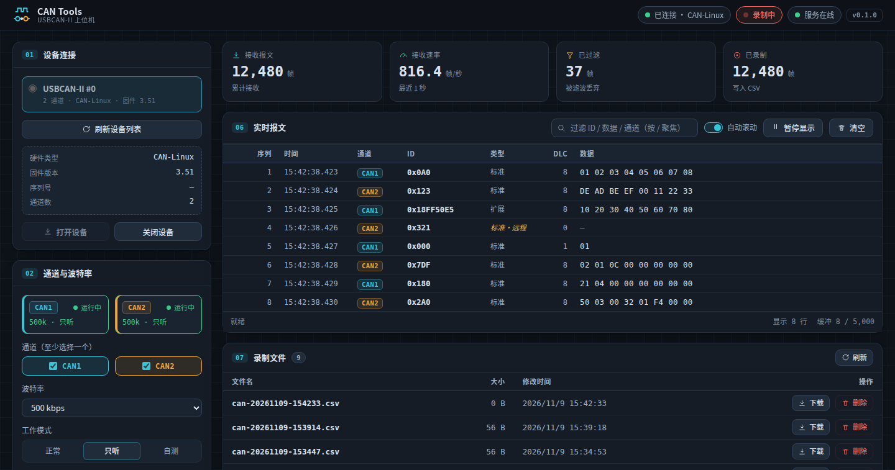
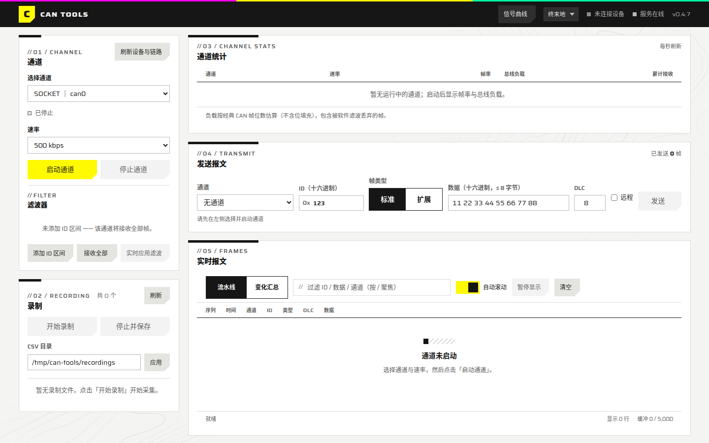

# CAN Tools

基于创芯科技 **USBCAN/CANalyst-II（04d8:0053，固件 CAN-Linux V3.51）** 的 Web 上位机。
Rust 后端直接通过 USB 与设备通信，浏览器前端负责配置与展示。

功能范围（按需求收敛）：

- 配置双通道 **波特率**（5k–1000k，每通道独立选择）与工作模式（正常 / 只听 / 自测）；
- **多链路并行**：USB 双通道之外可同时收发 Linux **SocketCAN** 链路（`can0`/`vcan0` 等），
  共用帧缓冲、统计、滤波与录制；
- **按通道**用 **ID 区间** 设置滤波（每通道可多条，标准/扩展分列）；USB 硬件验收滤波由该通道区间自动推导、软件层精筛；
- **运行时实时应用滤波**：区间立即生效，硬件预过滤热重初始化，不停止通道；
- **发送单帧**（标准/扩展/远程），并在自测模式下回环验证；
- 实时查看报文（流水线滚动 / 按 ID 汇总最新值并高亮变化字节），并 **保存为 CSV**；可下载、删除历史文件；
- **按通道**上传 DBC 定义，独立解码该通道报文并绘制实时曲线：单坐标系归一化叠加、共享时间轴；光标吸附后按 X 轴一次性列出各曲线读数，Y 轴虚线保留上次吸附曲线刻度（刷新/重启后定义仍保留）；
- **可切换界面主题**：插件式主题（默认「石墨工作台」玻璃面板/按键 / 「终末地」），顶栏切换并记忆；01–05 面板与按钮皮肤可由主题重定义，图表色板随主题实时切换；
- 单文件 AppImage 分发，内置静态前端，无需 Node 运行时。

| 默认 · 石墨工作台 | 终末地 |
|:---:|:---:|
|  |  |

## 快速开始

```bash
cargo run --release
```

默认监听 `127.0.0.1:8787` 并自动打开浏览器。常用参数：

```text
-H, --host <HOST>        监听地址 [default: 127.0.0.1]
-p, --port <PORT>        监听端口 [default: 8787]
    --data-dir <DIR>     数据目录（默认录制到其 recordings 子目录，可在页面修改）
    --no-browser         不自动打开浏览器
```

浏览器访问 `http://127.0.0.1:8787/`。数据目录默认遵循 XDG：
`$CAN_TOOLS_DATA_DIR` → `$XDG_DATA_HOME/can-tools` →
`$HOME/.local/share/can-tools` → 系统临时目录下的 `can-tools`。

> 服务默认仅监听回环地址且没有身份认证；若用 `--host 0.0.0.0` 暴露到局域网，
> 请自行确保网络可信。

## 设备权限

Linux 下非 root 用户需要 udev 规则：

```udev
# /etc/udev/rules.d/99-usbcan.rules
ACTION=="add", SUBSYSTEMS=="usb", ATTRS{idVendor}=="04d8", ATTRS{idProduct}=="0053", \
  GROUP="users", MODE="0666", ENV{ID_MM_DEVICE_IGNORE}="1"
```

```bash
sudo udevadm control --reload-rules && sudo udevadm trigger
```

重新插拔设备后生效。若设备被其他进程（如厂商工具）占用，打开会返回“接口被占用”。

## SocketCAN 链路

USB 之外还能同时接入 Linux SocketCAN 接口（PCAN/`vcan` 等），它们与 USB 通道并行收发，
共用帧缓冲、统计、软件滤波与录制：

- 发现：扫描 `/sys/class/net` 中 `type == 280` 的接口，按名字排序；在页面上勾选后
  「应用配置并启动」即可，通道 id 从 2 起分配（0/1 固定给 USB）。
- 自动启用：未启用的接口会在启动链路时由程序通过 netlink 设置速率并 `UP`
  （速率取该链路的 `/api/config` `socketcan[].bitrate`，默认 500000 bps，范围 1000–1000000）。
  该操作需要 **root 或 `CAP_NET_ADMIN`**；接口已经 UP 时不会执行任何特权操作，普通用户可直接使用。
  权限不足会返回可操作的错误提示，此时也可以手动执行
  `sudo ip link set can0 up type can bitrate 500000`。
- `vcan` 等虚拟接口不支持速率配置，设置速率的 `Operation not supported` 会被忽略，接口仍会启用，
  状态里的 `bitrate` 保持 `null`。
- 速率/工作模式由内核接口自身配置，页面中的波特率与硬件滤波只作用于 USB；软件滤波对所有
  链路生效。
- 关闭 USB 设备不会停止已运行的 SocketCAN 链路，也不需要 USB 设备即可开始录制。
- 新建网络命名空间里 sysfs 看不到接口（如手工创建的 `vcan0`），此时按名字配置仍可用，
  状态显示为 `unknown`。

## 滤波说明

滤波是**按通道**的：USB 的 CAN1/CAN2 与每条 SocketCAN 链路各自拥有自己的 ID 区间
（每通道最多 16 条，标准/扩展区分，`起始 ≤ ID ≤ 结束`），互不影响。页面上先用通道选择器
选中一个通道，再编辑它的区间；「应用配置并启动」提交各通道的区间，运行中修改则用
「实时应用滤波」只更新所选通道。提交时 USB 通道自动拆成两层执行：

- **硬件验收滤波（粗筛，仅 USB）**：由该通道的区间列表推导。取覆盖全部区间的最小 2 的幂对齐块，
  写入控制器：标准帧 `acc_code = blockStart << 21`、`acc_mask = (blockSize-1) << 21 | 0x001FFFFF`；
  扩展帧 `acc_code = blockStart << 3`、`acc_mask = (blockSize-1) << 3 | 0x00000007`；滤波方式 1。
  硬件块是区间并集的**超集**，多放行的帧由软件层剔除，因此不需要对齐到区间本身。
  区间列表为空、或同时混用标准/扩展帧时，退化为接收全部（`acc_code=0`、`acc_mask=0xFFFFFFFF`）。
- **软件 ID 区间滤波（精筛）**：主机侧对每个通道收到的帧用**该通道自己的**区间筛选，命中任一区间
  即保留，帧类型必须一致。列表为空时全部通过。SocketCAN 链路没有硬件验收滤波，只跑这一层。
- 配置变更会重启所选通道；未选中的通道保持运行，区间也不受影响。
- **实时应用滤波**：通道启动后，编辑区间并点击「实时应用滤波」即可生效，无需停止采集。
  区间（软件层）在主机侧立即切换；USB 通道推导出的硬件滤波变化时，对该通道执行
  `InitCAN + StartCAN`（不发送 `ResetCAN`、不关闭设备），实测通道保持运行。
  实时滤波只能作用于已启动的通道。
- 停止 SocketCAN 链路后其区间仍保留在链路注册表里，重新启动后继续生效；USB 通道停止后区间清空，
  下次应用配置时由前端重新提交。

> 验收滤波的归一化布局已在真实设备自测回环中验证，见
> `tests/hw_filter.rs`、`tests/hw_live_filter.rs` 与 `docs/protocol.md`。

## 发送报文

主界面“发送报文”栏支持单帧发送：

- 选择已启动的通道，填写十六进制 ID，选择标准/扩展；
- 数据支持 `11 22 33`、`112233` 或 `0x11,0x22,0x33`，最多 8 字节；
- 远程帧勾选“远程”，数据输入禁用，DLC 可设为 0–8；
- 发送要求设备已打开且目标通道已启动；只听模式不能发送。成功后更新“已发送”计数并写入运行日志。

在“自测”模式下，设备会把发送帧内部回环到接收端，可同时验证发送、接收与录制链路：

```bash
cargo test --test hw_selftest -- --ignored --nocapture
```

录制文件保存的是**接收帧**；正常总线模式下发送帧不会被本机回显，除非设备/总线回环。

## 报文保存
点击“开始录制”后，每帧写入当前录制目录下的 `can-YYYYmmdd-HHMMSS.csv`。录制目录默认是
`<数据目录>/recordings`，可在页面指定任意绝对路径（需要可写；设置会持久化到
`<数据目录>/recording-dir.txt`，重启后仍生效；正在录制时切换会保留当前文件、下一次录制写入新目录）。

```text
time,unix_ms,channel,link,id,id_hex,extended,remote,dlc,data
2026-11-09 15:00:00.123,1762681200123,1,CAN1,291,0x123,0,0,8,11 22 33 44 55 66 77 88
2026-11-09 15:00:00.124,1762681200124,3,can0,291,0x123,0,0,8,11 22 33 44 55 66 77 88
```

`channel` 从 1 开始（USB 为 1/2，SocketCAN 通道 id 2 对应 3），`link` 是通道名
（`CAN1`/`CAN2`/`can0`）。录制在停止录制或进程退出时 flush（关闭 USB 设备时若仍有
SocketCAN 链路在运行则继续录制）；写入失败会停止录制并记录错误，不影响实时查看。
只要还有运行中的 USB 通道或 SocketCAN 链路就能开始录制，不要求 USB 设备已打开。

## 运行日志

服务会同时把日志写到控制台和 `<数据目录>/logs/can-tools.log`（默认
`~/.local/share/can-tools/logs/`；用 `--data-dir` 或 `CAN_TOOLS_DATA_DIR` 时跟随数据目录）。
内容包括启动参数、通道与录制操作、驱动消息、API 错误以及 panic（带时间戳和线程名），
适合出问题时回传分析。

- 轮转：单文件 8 MiB，保留当前文件 + 3 个轮转文件（`can-tools.log.1`..`.3`，共约 32 MiB）。
- 级别：默认 `can_tools=info,canalyst_ii=info`；用 `RUST_LOG` 覆盖，例如
  `RUST_LOG=can_tools=debug,canalyst_ii=debug ./can-tools`。
- 获取方式：直接读取上述目录；或 `GET /api/logs` 列出文件、`GET /api/logs/{name}`
  下载（供开发/运维使用，页面不设入口）；systemd 部署也可 `journalctl -u can-tools`。
- 日志可能包含设备序列号、录制路径等本机信息，回传前请自行确认。

## 架构

```text
浏览器 (TypeScript, 无框架)
   │  REST / WebSocket
   ▼
axum (HTTP + WS 广播)
   │  命令 / oneshot 回复
   ▼
CAN 工作线程 (独占 libusb 句柄)
   │  轮询双通道 bulk IN + 协议编解码
   ▼
USBCAN/CANalyst-II (04d8:0053)
```

- `src/can/`：USB/SocketCAN 通道适配（实现 `CanChannel`）、公共类型与校验；
- `src/service/`：工作线程、配置/录制命令、CSV 记录器；
- `src/state.rs`：状态快照、实时帧环形缓冲（5000 帧）、事件广播；
- `src/server.rs`：REST、WebSocket、静态资源；
- `web/src/`：前端模块化 TypeScript 源码（`main.ts` 入口，按职责拆分）；`web/src/theme.ts`：主题注册/切换；`web/src/styles/`：CSS 源码，经 `index.css` 按序 `@import` 后由 esbuild 打包为单个 `web/app.css`；其中 `themes/` 是主题插件（`default`/`endfield`），`vendor/ui-shell.css` 是共享部件外壳；`web/src/html/`：HTML 片段源码（骨架 + include 标记），由 `web/scripts/build-html.mjs` 拼装为单文件 `web/index.html`，与 `web/app.js`、`web/app.css` 一并嵌入二进制。

协议字节布局见 [`docs/protocol.md`](docs/protocol.md)，HTTP API 见
[`docs/api.md`](docs/api.md)。

## 界面与主题

前端使用可插拔主题：`<html data-ui-theme="…">` 选择主题，`web/src/theme.ts` 管理注册表、顶栏选择器与
localStorage（key `can-tools-theme`），`web/src/styles/themes/**` 提供主题令牌与组件覆盖；
`web/src/styles/vendor/ui-shell.css` 只保留共享部件外壳（无主题身份令牌）。
内置两套主题：

- **`default` 石墨工作台（初始主题）**：冷灰纸面 + 静态极光地面；01–05 主面板、按钮、分段控件、
  输入框与曲线浮窗/弹窗为磨砂玻璃（半透明 + `backdrop-filter`，不支持时退化为哑光）；
  系统界面字体、蓝色强调；信号色点为圆形、自动滚动为胶囊开关、帧类型与流水线切换为滑块；
  等高线、尘埃与三色条隐藏。
- **`endfield` 终末地**：沿用 endfield-ui 标准变体与控制台页型——纸/墨/单一信号黄、切角只给可点击元素、
  细线分区、宽体 Saira + 中文黑体、静态等高线与动态尘埃（减少动态效果时只画静态一帧）。

主题覆盖范围包括 01–05 面板（`section.ui-panel[data-panel="01"…"05"]`）、`.ui-btn` 全状态、`.ui-seg`
分段与滑块、`.sig-chip`/`.dbc-msg`/`.sig-legend` 等曲线小件，以及弹窗/浮窗铬件、眉标前缀、空状态标记、
状态灯与徽标等 endfield 身份纹样；组件契约见 `web/src/styles/themes/index.css`。
新增主题需提供完整的 `--ui-*`、`--chart-1..3` 与 `--ui-eyebrow-prefix` 令牌（浅色/深色/系统深色兜底），
在 `themes/index.css` 追加 `@import`，并同步 `theme.ts` 与 `index.html` 早绘脚本里的主题 id。

页面变体参数写在 `web/src/html/index.html` 的 `<html>` 上（`data-ui-density="compact"`、
`data-ui-motion="calm"`）；endfield 主题另支持 `data-ui-accent/paper/cut/ground` 变体。
界面不使用游戏素材；endfield 主题自托管 Saira（SIL OFL 1.1，许可证见 `web/fonts/Saira-OFL.txt`），
默认主题使用系统字体栈。

## 构建

前置：Rust 1.82+、Linux；完整构建还需要 Node.js（用于生成前端产物）。`rusb` 启用 `vendored`，构建 libusb 不需要系统开发头文件。

首次构建（或改动前端后）先生成前端产物，它们不入库：

```bash
cd web
npm ci
npm run build     # 先拼装 web/index.html（src/html/），再 esbuild -> web/app.js（src/main.ts）与 web/app.css（src/styles/index.css）
npm run check     # 只做类型检查
cd ..
cargo build --release
cargo test --workspace --all-targets
```

`web/index.html`、`web/app.js` 与 `web/app.css` 都是构建产物、不入库；后端在编译时用 `include_str!` 嵌入它们，
产物缺失时 `build.rs` 会提示先执行 `npm run build`，因此 `cargo build` 前必须先生成前端产物。
`web/index.html` 由 `web/src/html/**` 的片段拼装而成，改页面结构请改片段源码而不是生成物。
endfield 主题使用自托管的 [Saira](https://github.com/googlefonts/saira-fonts)（SIL OFL 1.1，`web/fonts/Saira-OFL.txt`），
默认主题使用系统界面字体；中文均使用系统中文字体。

## CI / CD

GitHub Actions：

- `.github/workflows/ci.yml`：push / pull request 触发。先跑前端 `npm ci`、类型检查、测试与构建，再跑
  `cargo fmt --check`、`clippy -D warnings`、`cargo test`；通过后在 `ubuntu-24.04` 上用本机工具链
  构建 `.deb` 并上传为构建产物（保留 14 天）。
- `.github/workflows/release.yml`：推送 `v*` 标签触发。校验标签与 `Cargo.toml` 版本一致，重跑前端与
  Rust 测试，分别构建 **amd64 与 arm64** 的 `.deb`、AppImage（arm64 用 Zig + cargo-zigbuild 交叉编译），
  生成 `SHA256SUMS`，并创建 / 更新对应 GitHub Release。

发布新版本：

```bash
# 1. 更新 Cargo.toml / 子 crate / web/package*.json 版本
# 2. 提交并打标签（标签必须等于 v + Cargo.toml 的 version）
git commit -am "chore(release): bump version to X.Y.Z"
git tag -a vX.Y.Z -m "CAN Tools X.Y.Z"
git push origin main
git push origin vX.Y.Z
```

标签推送后 Release 工作流自动产出双架构安装包；CI 与 Release 都使用自带缓存的 Node 22 / stable Rust，
并安装 `libudev-dev`、`pkg-config`；Release 额外使用 Zig、cargo-zigbuild 与 arm64 target。

## Debian / Ubuntu 包（.deb）

适用于 Ubuntu/Debian 工控机；包内包含：

- `can-tools` 二进制与 `can-tools.service`（默认 `127.0.0.1:8787`、数据目录 `/var/lib/can-tools`）；
- `can-tools-can.service`：开机按 `/etc/default/can-tools-can` 自动把 SocketCAN 接口 up；
- `99-usbcan.rules`：把 USB 设备授权给 `can` 组。

```bash
# 默认本机架构；基于 zigbuild，glibc 2.17 基线
./packaging/build-deb.sh
# 交叉构建（如 aarch64 工控机）
ARCH=arm64 ./packaging/build-deb.sh
# 仅用本机工具链（产物要求构建机的 glibc）
ZIG=0 ./packaging/build-deb.sh

# 安装（创建 can 用户/组、udev 规则与 CAN 自启服务；应用不会自动启动）
sudo dpkg -i dist/can-tools_<version>_<arch>.deb
```

- **应用手动启动**：
  ```bash
  sudo systemctl start can-tools          # 本次启动
  sudo systemctl enable --now can-tools   # 需要开机自启时
  ```
  安装/升级不会自动启用或启动 `can-tools.service`；如果之前已被自动启用，升级会移除自启（不停止正在运行的进程）。
- **CAN 接口自动 up**：`can-tools-can.service` 开机读取
  `/etc/default/can-tools-can`（默认 `CAN_INTERFACES="can0:500000"`）；修改接口/速率后
  `sudo systemctl restart can-tools-can`。已 UP 的接口会跳过。
- 访问 `http://127.0.0.1:8787/`；远程查看用
  `ssh -L 8787:127.0.0.1:8787 jz@<host>`。
- USB 权限由包内 udev 规则授予 `can` 组，首次安装后重新插拔设备。
- 升级二进制后若应用正在运行，需要手动 `sudo systemctl restart can-tools` 才会用上新版本。
- 卸载：`sudo apt remove can-tools`（保留 `/var/lib/can-tools` 数据）。

## AppImage（可选）

```bash
./packaging/build-appimage.sh
# -> dist/can-tools-<version>-x86_64.AppImage
```

脚本会构建 release 二进制、组装 AppDir、下载 `appimagetool`（缓存于 `.tools/`）并
输出单文件 AppImage。可复用已编译二进制：

```bash
SKIP_BUILD=1 ./packaging/build-appimage.sh
```

交叉构建 arm64（x86 主机；`appimagetool` 用构建机架构，runtime 按目标架构下载）：

```bash
ARCH=arm64 ./packaging/build-deb.sh          # 先用 zigbuild 生成 arm64 二进制
ARCH=aarch64 BIN=target/aarch64-unknown-linux-gnu/release/can-tools \
  SKIP_BUILD=1 ./packaging/build-appimage.sh
```

部分发行版没有 `libfuse2`，可直接解包运行：

```bash
./can-tools-0.4.7-x86_64.AppImage --appimage-extract-and-run
```

## 交叉编译（cargo-zigbuild）

在较旧的发行版（glibc ≥ 2.17）或不同架构上运行时，用 `cargo-zigbuild` 以 zig 自带的
glibc 头文件构建，避免把宿主机的 glibc 版本带进二进制：

```bash
# 前置：zig、cargo-zigbuild、对应 rustup target，且已生成前端产物
cargo install cargo-zigbuild
rustup target add x86_64-unknown-linux-gnu     # aarch64: aarch64-unknown-linux-gnu
(cd web && npm ci && npm run build)

./packaging/build-zig.sh                                   # x86_64, glibc 2.17 基线
TARGET=aarch64-unknown-linux-gnu.2.17 ./packaging/build-zig.sh
```

产物在 `target/<triple>/release/can-tools`（例如
`target/x86_64-unknown-linux-gnu/release/can-tools`），可直接 scp 到目标机：

```bash
scp target/x86_64-unknown-linux-gnu/release/can-tools jz@<host>:~/
```

脚本设置 `LIBUDEV_NO_PKG_CONFIG=1`：vendored libusb 不做 udev 探测，避免把宿主的
`/usr/include` 与 glibc 2.38+ 符号带进目标二进制；应用只按需枚举设备，不依赖热插拔。
目标机仍需配置 USB 权限（见「设备权限」）。构建后可用
`objdump -T <binary> | grep -o 'GLIBC_[0-9.]*' | sort -V | tail -1` 检查所需的最高 glibc 版本。

## 测试与规范

```bash
cargo fmt --all -- --check
cargo clippy --workspace --all-targets -- -D warnings
cargo test --workspace --all-targets
```

- 硬件冒烟测试（需要真实设备，默认忽略）：
  `cargo test --test hw_smoke -- --ignored --nocapture`
- 自测模式回环（验证 TX 编码与 RX 解码全链路，需要真实设备）：
  `cargo test --test hw_selftest -- --ignored --nocapture`
- 硬件验收滤波布局（验证标准/扩展 ID 的归一化换算，需要真实设备）：
  `cargo test --test hw_filter -- --ignored --nocapture`
- 运行时滤波热更新（不 Reset 通道，需要真实设备）：
  `cargo test --test hw_live_filter -- --ignored --nocapture`
- 遵循 Google 风格的 Rust 约定：`rustfmt`、`clippy`、`snake_case`/`CamelCase`、
  公共项文档注释；提交信息使用英文 Conventional Commits。
- 协议实现的关键不变量（RX 双半块、ID 0、0x340 魔数、0x07 关闭序列）在源码
  注释与 `docs/protocol.md` 中均有说明，修改前请先阅读。

## 范围与限制

- 仅支持 CAN 2.0（标准/扩展/远程帧），不支持 CAN-FD；
- 同一进程一次管理一台 USBCAN 设备（双通道）与最多 64 条 SocketCAN 链路；
  发送为单帧手动发送，暂不支持周期/批量发送；
- 设备关闭后需要数百毫秒重新枚举，程序会在近期关闭过的场景自动重试；
- 浏览器端保留最近 5000 帧，历史报文请使用录制功能。

## 参考与致谢

协议与硬件行为来自同一工作区的参考实现：

- `can_service/usbcan_driver_gs`：C 规范版驱动（协议权威）；
- `can_service/multi-can/crates/usbcan-async`：Rust 异步驱动与协议注释；
- `can_service/usbcan-rs`：早期同步 Rust 驱动。

本项目按上述协议重新实现并针对 Web 上位机场景裁剪，未直接引入这些 crate。

## License

MIT，见 [LICENSE](LICENSE)。
